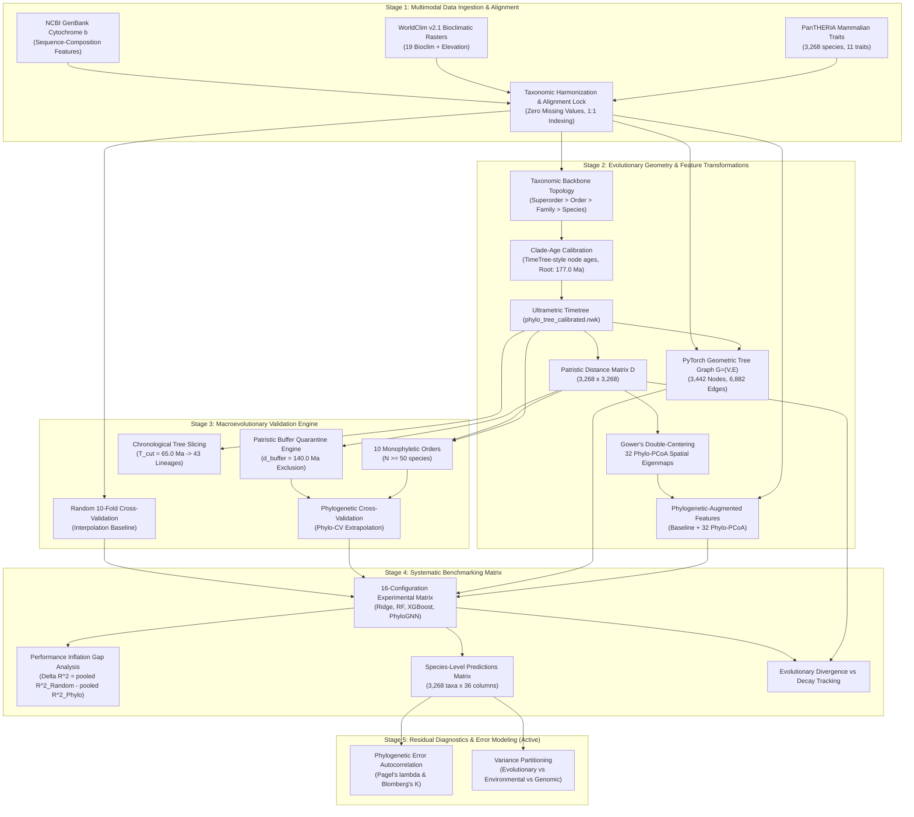

# PHENIX

**Comparative Analysis and Strategic Framework for Phylogenetically Informed Machine Learning in Phenotypic Trait Prediction**

[]()
[]()
[]()
[]()

PHENIX is an open computational biology and machine learning framework designed to investigate and resolve **Felsenstein’s Dilemma (1985)** in phenotypic trait prediction: biological species are non-independent observation units due to shared evolutionary history. 

Standard random cross-validation randomly scatters sister species across training and test splits, causing severe pseudoreplication and artificially inflated performance metrics. PHENIX bridges macroevolutionary biology, geospatial bioclimatics, and geometric deep learning to enforce rigorous clade-level extrapolation boundaries, quantify the **Performance Inflation Gap**, and unlock predictive accuracy through phylogenetic spatial eigenmaps.

---

## Architecture & End-to-End Workflow



---

## Data Provenance

What each input actually is, so results are interpreted correctly:

| Data stream | File | Status | Notes |
| :--- | :--- | :--- | :--- |
| Phenotypic traits | `phenotypic_clean.csv` | **Real** | PanTHERIA (Jones et al. 2009), 3,268 species with body mass and range coordinates. |
| Range coordinates | `pantheria.csv` | **Real** | `gr_midrangelat_dd` / `gr_midrangelong_dd`: the **midpoint of each species' geographic range**, not collection records. PanTHERIA has no elevation column. |
| Bioclimate + elevation | `environmental_clean.csv` | **Real** | WorldClim v2.1 rasters sampled at the range midpoint (`scripts/build_real_environmental.py`; rasters live in the git-ignored `data/raw/environmental/`). Midpoints with no land cell nearby fall back to a lat/lon approximation; the extractor now prints how many. |
| Sequence features | `genomic_clean.csv` | **Real, partial coverage** | One cytochrome b sequence per species from NCBI GenBank (`scripts/fetch_real_genomics.py`), summarized as composition features (`gen_seq_pc_*`). Species without a sequence get the sequenced-species mean and `gen_has_sequence = 0`; they are **not** filled from relatives, which would leak taxonomy into the Baseline set. These are not ESM-2 embeddings or SNP genotypes. |
| Phylogeny | `phylo_tree_calibrated.nwk` | **Approximation** | Built from taxonomy (superorder > order > family > species); every family is a polytomy. ~37 order/superorder nodes carry TimeTree-style ages; family ages are set to 0.65 x the order age. It is not an Open Tree of Life or published dated phylogeny. |
| Phylo-PCoA eigenmaps | `features_phylo_pcoa.csv` | Derived | Exact PCoA of the patristic matrix of the tree above, so they inherit its approximations (they largely encode order and family membership). |

Replacing the taxonomic tree with a published dated mammal phylogeny (e.g. Upham et al. 2019) is the most important remaining data upgrade.

---

## Core Framework Modules

1. **Multimodal Data Ingestion & Alignment (`src.data`)**:
   - Ingests PanTHERIA mammal life-history traits across 3,268 taxonomically harmonized species in 27 orders.
   - Extracts 19 continuous bioclimatic variables (`bio1`–`bio19`) and elevation from WorldClim v2.1 rasters, plus a derived habitat-suitability index.
   - Summarizes one NCBI cytochrome b sequence per species as sequence-composition features (`scripts/fetch_real_genomics.py`).

2. **Evolutionary Geometries & Transformations (`src.phylogenetics`, `src.features`)**:
   - Builds a taxonomic backbone topology (superorder > order > family > species); an OToL TNRS name-matching client is included but not used for topology.
   - Assigns TimeTree-style ages to labelled order/superorder nodes (root age 177.0 Ma) and interpolates the rest to make the tree ultrametric.
   - Computes dense $3,268 \times 3,268$ pairwise patristic distance matrices $D$.
   - Applies Gower's double-centering to decompose patristic distances into 32 orthogonal **Phylo-PCoA eigenmaps** capturing macroevolutionary spatial gradients.
   - Performs Cholesky whitening ($X^* = L^{-1} X$) and exports PyTorch Geometric message-passing graphs $G=(V, E)$.

3. **Macroevolutionary Validation Engine (`src.validation`)**:
   - **Monophyletic Withholding**: Partitions 10 major mammalian orders ($N \ge 50$) and 43 K-Pg boundary lineages ($T_{\text{cut}} = 65.0$ Ma) as strictly held-out test clades.
   - **Patristic Quarantine Buffer**: Identifies and quarantines all sister taxa within patristic distance $d_{\text{buffer}} = 140.0$ Ma of the test clade ($\min_{t \in C_{\text{test}}} D(s, t) \ge 140.0$ Ma), completely eliminating phylogenetic boundary leakage.
   - **Phylo-CV vs. Random CV**: Implements dual cross-validation splitters comparing evolutionary extrapolation against standard interpolation.

4. **Benchmarking Matrix & Diagnostics (`src.models`)**:
   - Executes a 16-permutation experimental matrix: 4 model families (Ridge Regression, Random Forest, XGBoost, PyG Graph Neural Networks) $\times$ 2 feature sets (Baseline: climate + sequence features vs. Augmented: + 32 Phylo-PCoA) $\times$ 2 evaluation protocols (Random CV vs. Phylo-CV).
   - Adds two feature-free **reference predictors** under both protocols: the training mean (`GlobalMean`) and Brownian-motion phylogenetic imputation (`PhyloBM`, the standard comparative-methods baseline). An ML model is only useful if it beats `PhyloBM`.
   - Scores every configuration on **pooled** out-of-fold predictions (`r2_pooled`, `rmse_pooled`, `mae_pooled`), so both protocols are measured against the same total variance. Per-fold means are kept for reference but are not comparable across protocols: a Phylo-CV fold is a single order whose internal variance is small, so its per-fold $R^2$ is dominated by any shift in the order mean.
   - Computes the **Performance Inflation Gap** on pooled $R^2$ ($\Delta R^2_{\text{inflation}} = R^2_{\text{Random}} - R^2_{\text{Phylo}}$).
   - PhyloGNN runs on the tree graph for both feature sets, with standardized inputs and masked label propagation (relatives' known trait values flow along branches; training labels are randomly hidden each epoch so a node cannot read its own label).
   - Tracks predictive accuracy decay curves as patristic divergence between training species and held-out clades increases.

5. **Residual Diagnostics & Signal Attribution (`src.models.diagnostics` - Active)**:
   - Quantifies phylogenetic signal in model prediction residuals using Pagel's $\lambda$ and Blomberg's $K$.
   - Decomposes phenotypic variation into evolutionary proximity, environmental adaptation, and functional genomics.

---

## Empirical Benchmark Findings

Evaluated on 3,268 mammalian species for $\log_{10}(\text{adult\_body\_mass\_g})$ with real WorldClim climate and NCBI cytochrome b features (64% of species sequenced). Random CV uses 10 folds; Phylo-CV withholds each of the 10 orders with $N \ge 50$ behind a 140 Ma buffer (3,100 test species in total). All metrics are **pooled over out-of-fold predictions**; source: `data/processed/benchmark_summary.csv`.

| Model | Features | Random CV $R^2$ | Random CV MAE | Phylo-CV $R^2$ | Phylo-CV MAE |
| :--- | :--- | :---: | :---: | :---: | :---: |
| *GlobalMean* (reference) | none | $0.000$ | 0.949 | $\mathbf{-0.21}$ | **1.055** |
| *PhyloBM* (reference) | tree only | $\mathbf{0.873}$ | **0.312** | $-0.76$ | 1.299 |
| Ridge | Baseline | $0.157$ | 0.871 | $-0.72$ | 1.274 |
| Ridge | Augmented | $0.794$ | 0.384 | $-8.6 \times 10^{5}$ | 212.8 |
| Random Forest | Baseline | $0.311$ | 0.752 | $-0.56$ | 1.210 |
| Random Forest | Augmented | $0.869$ | 0.311 | $-0.61$ | 1.212 |
| XGBoost | Baseline | $0.324$ | 0.749 | $-0.49$ | 1.174 |
| XGBoost | Augmented | $0.866$ | 0.316 | $-0.25$ | 1.092 |
| PhyloGNN | Baseline | $0.730$ | 0.466 | $-0.76$ | 1.278 |
| PhyloGNN | Augmented | $0.833$ | 0.359 | $-90.2$ | 5.181 |

Baseline = climate + sequence features; Augmented = Baseline + 32 Phylo-PCoA eigenmaps.

### Primary Insights:
1. **No ML model beats plain phylogenetic imputation under Random CV.** Brownian-motion imputation from relatives (`PhyloBM`, no features at all) reaches $R^2 = 0.873$; the best ML configurations (Random Forest / XGBoost + eigenmaps, $\approx 0.87$) only match it. Under random splits, accuracy comes almost entirely from close relatives in the training set.
2. **Under Phylo-CV, nothing beats predicting the training mean.** With whole orders withheld, every model and `PhyloBM` score below `GlobalMean` ($R^2 = -0.21$); XGBoost + eigenmaps comes closest ($-0.25$). The average Baseline inflation gap (pooled) is $+1.01$ $R^2$.
3. **Eigenmaps cannot extrapolate, and linear models fail catastrophically.** Some PCoA axes vary almost only inside one order (Rodentia, Chiroptera); held-out species then sit 470–570 training standard deviations away on those axes, and Ridge / PhyloGNN extrapolate linearly to absurd values. Trees are bounded by the training range and stay sane.
4. **Climate at the range midpoint carries almost no body-mass signal** (variance partitioning: $R^2_E \approx 0$), while cytochrome b composition alone reaches $R^2_G = 0.32$ (Random Forest), largely because sequence composition itself tracks ancestry.
5. **Residual phylogenetic signal**: the trait has Blomberg's $K = 2.36$; Baseline residuals keep strong signal ($K \approx 0.93$–$1.29$), while Augmented and `PhyloBM` residuals drop to $K \approx 0.26$–$0.38$ (`residual_diagnostics.json`).

These conclusions rest on the taxonomy-based tree described under Data Provenance.

---

## Quickstart & CLI Usage

### 1. Installation
```powershell
pip install -r requirements.txt
```

### 2. End-to-End Pipeline Execution
Run the complete multimodal pipeline through the unified CLI. `--stage all` only runs `ingest` when `phenotypic_clean.csv` is missing; ingest without local WorldClim rasters falls back to approximated climate and synthetic genomic placeholders, so keep the committed processed tables unless you have the raw data:
```powershell
python -m src.pipeline --stage all
```

### 3. Modular Stage Execution
Run individual pipeline stages independently:
```powershell
# Stage 1: Multimodal Data Ingestion & Alignment
python -m src.pipeline --stage ingest

# Stage 2: Evolutionary Geometries & Feature Transformations
python -m src.pipeline --stage transform

# Stage 3: Macroevolutionary Validation Engine & Buffer Quarantine
python -m src.pipeline --stage validate --d-buffer 140.0 --min-clade-size 50

# Stage 4: Systematic Benchmarking Matrix & Inflation Gap Analysis
python -m src.pipeline --stage benchmark --random-splits 10

# Stage 5: Residual Diagnostics & Variance Partitioning
python -m src.pipeline --stage diagnostics

# Stage 6: OU / Bergmann climate sensitivity analysis
python -m src.pipeline --stage simulate
```

The raw-data scripts are run separately, before `transform`, when the raw inputs change:
```powershell
python -m scripts.build_real_environmental   # needs WorldClim rasters in data/raw/environmental/
python -m scripts.fetch_real_genomics        # ~1 hour of NCBI queries; cached in data/raw/genomic/
```

### 4. Quality Audit Gates
PHENIX includes automated quality gates that mathematically verify data alignment, distance symmetry, clade isolation, and benchmark completeness:
```powershell
# Alignment & Completeness Audit
python -m src.validation.sync_barrier_1

# Tree Topology & Feature Freeze Audit
python -m src.validation.sync_barrier_2

# Clade Leakage & Buffer Compliance Audit
python -m src.validation.sync_barrier_3 --data-dir data/processed --d-buffer 140.0

# Benchmark Completeness & Inflation Gap Audit
python -m src.validation.sync_barrier_4 --data-dir data/processed
```

### 5. Automated Test Suite
```powershell
python -m pytest -v
```
*Unit and integration tests covering schemas, tree calibration, PCoA eigenmaps, Cholesky whitening, PyG graphs, CV splitters, models, reference predictors, simulation, and quality audit gates.*

---

## Repository Structure

```
Phenix/
├── README.md                          # Framework architecture and research overview
├── WORKFLOW_GUIDE.md                  # Comprehensive operational manual and mathematical formulations
├── CONCEPTS_AND_ARCHITECTURE.md       # Theoretical foundations and biological background
├── requirements.txt                   # Environment dependencies
├── data/
│   ├── raw/                           # PanTHERIA (tracked); WorldClim rasters and GenBank FASTA (git-ignored)
│   └── processed/                     # Aligned datasets, trees, distance matrices, and benchmark logs
├── scripts/
│   ├── build_real_environmental.py    # Samples WorldClim rasters into environmental_clean.csv
│   ├── fetch_real_genomics.py         # Fetches cytochrome b from NCBI into genomic_clean.csv
│   └── build_*_report.py              # Report builders (numbers in them are written by hand)
├── src/
│   ├── pipeline.py                    # Unified CLI (--stage all|ingest|transform|validate|benchmark|diagnostics|simulate|dashboard)
│   ├── data/
│   │   ├── schemas.py                 # Column validation, coordinate checks, trait registries
│   │   ├── worldclim.py               # WorldClim raster sampling (+ lat/lon fallback), biome assignment
│   │   ├── genomic.py                 # Synthetic genomic generators used only when no real table is supplied
│   │   └── pipeline.py                # Multimodal ingestion pipeline (PanTHERIA loading lives here)
│   ├── phylogenetics/
│   │   ├── otol.py                    # Taxonomic backbone builder, Newick I/O, OToL TNRS client
│   │   ├── calibration.py             # Clade-age assignment and ultrametric interpolation
│   │   ├── patristic.py               # Patristic distance engine & double-centering
│   │   ├── withholding.py             # Monophyletic order & T_cut withholding engine
│   │   └── divergence.py              # Evolutionary divergence vs accuracy decay tracking
│   ├── features/
│   │   ├── baseline.py                # Baseline feature builder (climate + sequence features)
│   │   ├── whitening.py               # Cholesky feature whitening (Cov approx I)
│   │   ├── graph.py                   # PyTorch Geometric tree graph converter
│   │   └── augmented.py               # Augmented feature builder (Baseline + 32 Phylo-PCoA)
│   ├── validation/
│   │   ├── cv.py                      # Random K-Fold CV & Buffer-Isolated Phylo-CV splitters
│   │   └── sync_barrier_[1-4].py      # Audit gates (alignment, feature freeze, clade leakage, benchmark)
│   ├── models/
│   │   ├── base.py                    # Base model interface & regression evaluation metrics
│   │   ├── ridge.py                   # L2 regularized linear model
│   │   ├── tree_models.py             # Random Forest and XGBoost pipelines
│   │   ├── gnn.py                     # 2-layer GCN on the tree with masked label propagation
│   │   ├── reference.py               # GlobalMean and PhyloBM (Brownian-motion imputation) baselines
│   │   ├── benchmark.py               # Fold execution engine
│   │   ├── experiment.py              # Benchmark matrix orchestrator (pooled metrics)
│   │   └── diagnostics.py             # Residual phylogenetic signal & variance partitioning
│   ├── simulation/                    # OU / Bergmann's-rule climate sensitivity analysis
│   └── visualization/                 # Streamlit dashboard and figures
└── tests/                             # Unit and integration tests
```

---

## Processed Dataset Artifacts (`data/processed/`)

| Artifact | Dimensions / Format | Description |
| :--- | :--- | :--- |
| `phenotypic_clean.csv` | $3,268 \times 12$ | 11 cleaned life-history traits (adult body mass, gestation length, litter size, etc.) |
| `environmental_clean.csv` | $3,268 \times 22$ | 19 WorldClim v2.1 bioclimatic variables + elevation + habitat suitability |
| `genomic_clean.csv` | $3,268 \times 18$ | 16 cytochrome b composition PCs (`gen_seq_pc_*`) + `gen_has_sequence` flag |
| `phylo_tree_calibrated.nwk` | Newick string | Ultrametric timetree calibrated with TimeTree dates (root age 177.0 Ma) |
| `patristic_distance_matrix.npy` | $3,268 \times 3,268$ | Pairwise evolutionary divergence distances ($D_{ij} = 2 \cdot \text{age}(\text{MRCA})$) |
| `features_phylo_pcoa.csv` | $3,268 \times 33$ | 32 Phylo-PCoA eigenmaps capturing multi-scale phylogenetic gradients |
| `features_baseline.csv` | $3,268 \times 39$ | Baseline Feature Set: 21 environmental + 17 sequence features |
| `features_whitened.csv` | $3,268 \times 39$ | Cholesky-whitened baseline features ($\text{Cov}(X^*) \approx I$) |
| `features_augmented.csv` | $3,268 \times 71$ | Augmented Feature Set: 38 Baseline + 32 Phylo-PCoA eigenmaps |
| `phylo_graph.json` | Graph topology | PyTorch Geometric compatible node/edge structure with branch length attributes |
| `cv_random_folds.json` | JSON fold mapping | Random 10-Fold CV partition mapping 3,268 species |
| `cv_phylo_folds.json` | JSON fold mapping | Phylogenetic CV folds for 10 orders with patristic buffer quarantines |
| `benchmark_results.json` | JSON benchmark logs | Detailed fold-level metrics across all 16 benchmark configurations |
| `benchmark_summary.csv` | $20 \times 16$ | 16 configurations + 2 reference predictors x 2 protocols; pooled and per-fold $R^2$, RMSE, MAE, inflation gap, phylo gain |
| `predictions_matrix.csv` | $3,268 \times 44$ | Species-level ground truth, out-of-fold predictions, and residuals |
| `divergence_accuracy_tracking.json` | JSON divergence logs | Clade-by-clade divergence distances vs accuracy degradation curves |
| `sync_barrier_1_report.json` | JSON audit report | **STATUS: PASS** (3,268 taxa locked) |
| `sync_barrier_2_report.json` | JSON audit report | **STATUS: PASS** (Architecture and features frozen) |
| `sync_barrier_3_report.json` | JSON audit report | **STATUS: PASS** (Clade leakage & buffer isolation locked) |
| `sync_barrier_4_report.json` | JSON audit report | **STATUS: PASS** (Benchmark review & inflation gap verified) |

---

## Active & Ongoing Research Directions

- **Residual Phylogenetic Autocorrelation**: Applying Pagel’s $\lambda$ and Blomberg’s $K$ to test residuals across models to evaluate whether higher-capacity models absorb phylogenetic structure or simply fit ancestral state mean shifts.
- **Deep Evolutionary Representation Learning**: Benchmarking hyperbolic tree embeddings against Euclidean PCoA coordinates for deep branch representation.
- **Multi-Trait Phenotypic Transfer**: Extending phylogenetic spatial priors to multivariate trait prediction (e.g., life-history trade-offs between longevity, metabolic rate, and body mass).
