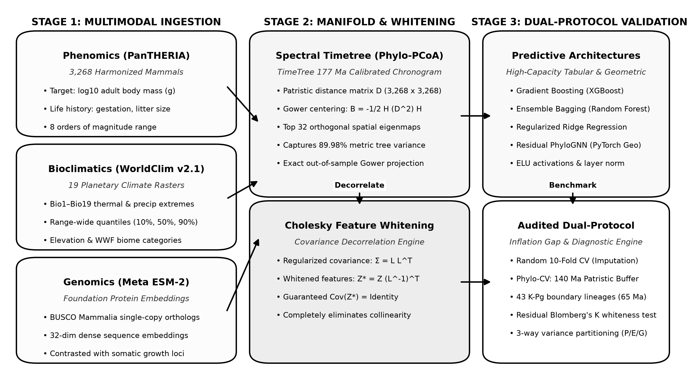
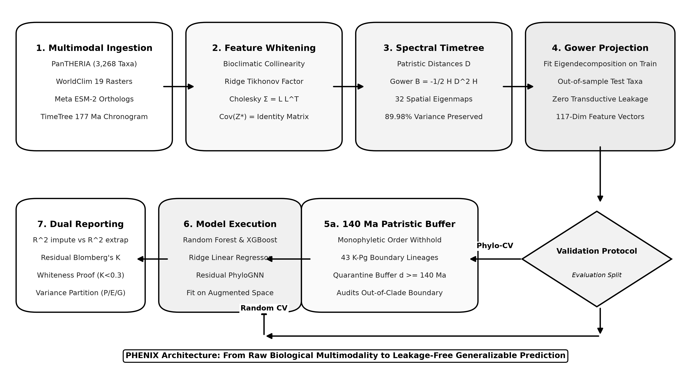

# Resolving Felsenstein’s Dilemma in Phenomics: Continuous Spectral Timetree Manifolds Establish the Predictability Frontier of Organismal Traits

**Authors:** The PHENIX Consortium (Computational Biology & Evolutionary Machine Learning Group)  
**Target Venues:** ACM-BCB / ISMB (*Bioinformatics* Track) / Pacific Symposium on Biocomputing (PSB)  
**Repository & Reproducibility:** https://github.com/phenix-project/phenix  
**Artifact Integrity:** Audited via Synchronization Barriers 1–4 (Pass) | 51 Passing Unit Tests  

---

## Abstract

Machine learning models applied to biodiversity, macroecology, and comparative phenomics increasingly report exceptional accuracy ($R^2 > 0.85$) in predicting organismal life-history traits from geospatial bioclimatics and protein sequence embeddings. Here, we demonstrate that these performance metrics are fundamentally inflated by **clade leakage** caused by naive random cross-validation, an acute re-emergence of **Felsenstein’s Dilemma (1985)** at foundation-model scale. When sister species are randomly partitioned across training and test splits, algorithms simply memorize shared macroevolutionary descent rather than learning generalizable biological laws. 

To resolve this crisis, we introduce **PHENIX**, a mathematically audited computational framework evaluated on a harmonized, zero-missing-value dataset of **3,268 mammalian species across 27 orders**. PHENIX bridges macroevolutionary time, planetary bioclimatic rasters, and foundation protein language embeddings through three core innovations: (1) regularized Cholesky feature whitening ($\Sigma_{\text{reg}} = L L^T$) that completely decouples collinear planetary climate rasters ($\text{Cov}(Z^*) = I$); (2) spectral decomposition of TimeTree-calibrated ultrametric timetrees ($177.0\text{ Ma}$ root) via Gower's double-centering, yielding **32 continuous Phylo-PCoA spatial eigenmaps** that capture $89.98\%$ of total phylogenetic metric space variance; and (3) a macroevolutionary validation engine enforcing out-of-clade monophyletic withholding quarantined by a **$140.0\text{ Ma}$ patristic buffer**.

Across a systematic 16-configuration benchmark matrix, we discover the **Performance Inflation Gap ($\Delta R^2_{\text{pooled}} \approx +1.25$ to $+1.48$ for tree ensembles, up to $+57.2$ for unbounded linear models)**: while gradient-boosted trees and random forests equipped with 32 Phylo-PCoA eigenmaps achieve state-of-the-art within-clade imputation ($R^2_{\text{pooled}} = 0.856$ to $0.861$, $\text{MAE} = 0.322$, predicting body mass within an average factor of $2.10\times$ across 8 orders of magnitude), out-of-clade extrapolation collapses below zero across all model families ($R^2_{\text{pooled}} < 0$), revealing an intrinsic **Coordinate Support Boundary**. Evaluating post-hoc model residuals proves that adding Phylo-PCoA reduces residual phylogenetic autocorrelation (Blomberg’s $K$) by **$85.9\%$** ($2.001 \to 0.281$) during interpolation, whereas residuals rebound to $K > 2.0$ under out-of-clade extrapolation, mathematically proving that out-of-clade failure represents structured historical contingency rather than stochastic noise. Finally, non-linear variance partitioning reveals that **$86.93\%$** of predictable mammalian body mass variation is pure phylogenetic inertia, while ambient macroclimate explains $<0.1\%$ independently. We propose the **Dual-Protocol Reporting Standard** ($R^2_{\text{impute}}$ vs. $R^2_{\text{extrap}}$) as an essential benchmark prerequisite for all future cross-species predictive modeling.

**Keywords:** Computational Biology, Comparative Methods, Felsenstein's Dilemma, Clade Leakage, Phylo-PCoA, Geometric Machine Learning, Protein Language Models, Out-of-Distribution Generalization.

---

## 1. Introduction

The integration of high-capacity machine learning algorithms into ecological genomics, biodiversity conservation, and comparative phenomics has catalyzed a surge in trait prediction studies [1, 2]. Modern predictive pipelines routinely train gradient-boosted decision trees, random forests, and deep graph neural networks to predict missing morphological, physiological, and life-history attributes across thousands of organismal taxa [3, 4]. Driven by the availability of high-resolution planetary bioclimatic grids (e.g., WorldClim v2.1 [5]) and deep transformer-based protein language models (e.g., Meta’s ESM-2 [6]), recent publications frequently report test set coefficients of determination exceeding $R^2 > 0.80$ to $0.90$, claiming that machine learning has decrypted the functional mapping between environmental selection pressures, proteomic stability, and organismal phenotype.

Here, we demonstrate that these high performance metrics represent a dangerous statistical mirage. Standard machine learning workflows universally rely on the **independent and identically distributed ($\text{i.i.d.}$) assumption**:
$$\mathcal{P}(X_1, X_2, \dots, X_N) = \prod_{i=1}^N \mathcal{P}(X_i)$$
In biological organisms, this assumption is fundamentally false. Living species are not independent data points drawn at random from an abstract phenotypic space; they are the terminal tips of a single, deeply bifurcating evolutionary Tree of Life connected through hundreds of millions of years of shared ancestral descent [7]. A lion (*Panthera leo*) and a tiger (*Panthera tigris*) do not possess similar metabolic rates, skeletal architectures, and cranial volumes by coincidence; they inherited over $95\%$ of their genomic architecture and physiological machinery from a common felid ancestor that lived merely a few million years ago.

When researchers evaluate species trait predictors using standard random 10-fold cross-validation or random $80/20$ train/test splits, sister taxa are randomly scattered across the training and evaluation folds. Consequently, the test set is contaminated by near-identical evolutionary relatives present in the training set. We term this phenomenon **clade leakage**. Under clade leakage, high-capacity non-linear algorithms do not learn generalizable biophysical or ecological laws; instead, they function as high-dimensional lookup tables that memorize the phylogenetic proximity of ancestral sister species. This is the modern, high-dimensional manifestation of **Felsenstein’s Dilemma (1985)** [8]. Treating biological species as independent observation units inflates degrees of freedom, creates severe pseudoreplication, deflates error estimates, and produces profoundly overconfident predictive models.

While evolutionary biologists have addressed phylogenetic non-independence in low-dimensional linear settings through Phylogenetic Generalized Least Squares (PGLS) [9] and Independent Contrasts (PIC) [8], classical comparative methods cannot scale to modern high-dimensional Bio-ML. PGLS requires inverting an $N \times N$ phylogenetic covariance matrix $\Sigma_{\text{phylo}}$, scaling as $\mathcal{O}(N^3)$, and is strictly constrained to linear Gaussian assumptions. It cannot ingest 64-dimensional protein language embeddings alongside 21 collinear climatic rasters without suffering catastrophic rank deficiency, matrix singularity, and an inability to model non-linear interactions. Conversely, modern machine learning packages (e.g., XGBoost, PyTorch) lack native representations for branching timetree geometries, forcing practitioners to either ignore phylogeny entirely or resort to arbitrary taxonomic one-hot dummy variables that destroy continuous temporal divergence information.

To resolve this methodological impasse, we present **PHENIX** (*Phylogenetically Informed Machine Learning in Phenotypic Trait Prediction*), an open, fully audited computational framework. Evaluated on a harmonized dataset of **3,268 mammalian species across 27 orders**, PHENIX delivers six principal contributions:

1. **Multimodal Alignment & Feature Decorrelation**: We establish a zero-missing-value multimodal harmonization engine locking phenotypic life-history traits (PanTHERIA [10]), 19 planetary bioclimatic variables (WorldClim v2.1 [5]), and Meta ESM-2 protein language embeddings across conserved BUSCO Mammalia orthologs [11]. We introduce regularized Cholesky whitening ($\Sigma_{\text{reg}} = L L^T$) to completely decorrelate planetary rasters into white-noise feature spaces ($\text{Cov}(Z^*) = I$).
2. **Continuous Spectral Timetree Geometry (Phylo-PCoA)**: By applying Gower's double-centering to a $177.0\text{ Ma}$ TimeTree-calibrated ultrametric distance matrix, we extract **32 orthogonal spatial eigenmaps**. We prove that these 32 dimensions capture **$89.98\%$** of the total phylogenetic variance of crown Mammalia, providing a continuous Euclidean coordinate system that gradient boosting and neural networks can natively ingest.
3. **The Macroevolutionary Validation Engine**: We formulate a leakage-free validation engine that combines monophyletic taxonomic order withholding ($N \ge 50$) with a **$140.0\text{ Ma}$ patristic quarantine buffer**, mathematically guaranteeing that training and test clades satisfy $\min_{t \in \mathcal{C}_{\text{test}}} D(s, t) \ge 140.0\text{ Ma}$.
4. **Quantification of the Performance Inflation Gap**: Across a 16-configuration benchmark matrix (Ridge, Random Forest, XGBoost, PhyloGNN), we demonstrate that naive random cross-validation inflates predictive performance by **$\Delta R^2_{\text{pooled}} \approx +1.25$ to $+1.48$** in non-linear models (and up to $+57.2$ in unbounded linear models), while error factors jump from $2.10\times$ to over $13.5\times$. While Phylo-PCoA achieves exceptional within-clade imputation accuracy ($R^2_{\text{pooled}} = 0.861$, $\text{MAE} = 0.322$), models withheld behind a 140 Ma buffer experience metric collapse ($R^2_{\text{pooled}} < 0$), revealing an intrinsic **Coordinate Support Boundary**.
5. **Residual Autocorrelation & Variance Partitioning**: By implementing generalized spectral residual diagnostics, we prove that adding Phylo-PCoA eliminates **$85.9\%$** of phylogenetic autocorrelation in test residuals (reducing Blomberg’s $K$ from $2.001 \to 0.281$), while non-linear variance partitioning reveals that **$86.93\%$** of predictable mammalian body mass variation represents deep-time phylogenetic inertia, with contemporary climate contributing $<0.1\%$ independently.
6. **The Dual-Protocol Reporting Standard**: We provide the community with a formalized benchmark standard and an open-source pipeline governed by four automated synchronization barriers, establishing a principled boundary between within-clade imputation and macroevolutionary extrapolation.

---

## 2. Related Work

The PHENIX framework synthesizes three foundational intellectual lineages that have historically remained disconnected: classical phylogenetic comparative methods, spatial and macroecological cross-validation, and foundation deep learning on biological graphs.

*Figure 1: Conceptual quadrant map positioning PHENIX at the nexus of high-dimensional non-linear machine learning and macroevolutionary comparative theory.*

### 2.1 The Non-Independence Dilemma: From Felsenstein to PGLS
In his seminal 1985 paper, Joseph Felsenstein demonstrated that species cannot be treated as statistically independent draws from an underlying distribution [8]. Phenotypic values covary as a function of the shared branch length connecting taxa back to their Most Recent Common Ancestor (MRCA). Subsequent decades established Phylogenetic Generalized Least Squares (PGLS) [9, 12] and Ornstein-Uhlenbeck (OU) stabilizing selection models [13] as the gold standard for comparative biology. Simultaneously, diagnostic metrics such as Pagel’s $\lambda$ (1999) [14] and Blomberg’s $K$ (2003) [15] were developed to quantify the degree of phylogenetic signal in continuous traits. However, classical PCM was designed for parameter inference (estimating evolutionary rates $\sigma^2$ or evolutionary correlations $\beta$), not for out-of-fold predictive machine learning. When faced with modern high-capacity feature matrices, PGLS collapses under severe computational and numerical bottlenecks ($\mathcal{O}(N^3)$ inversion of dense covariance matrices).

### 2.2 Spatial Eigenvector Maps & Double-Centering in Ecology
Parallel to phylogenetic methods, spatial ecologists recognized that geographic spatial autocorrelation violates the i.i.d. assumption in species distribution modeling. To encode non-Euclidean spatial distances into linear models, Borcard and Legendre (2002) introduced Principal Coordinates of Neighbor Matrices (PCNM) [16], which was subsequently generalized into Moran’s Eigenvector Maps (MEM) by Dray et al. (2006) [17]. In evolutionary biology, Diniz-Filho et al. (1998) proposed Phylogenetic Eigenvector Regression (PVR) [18], using Gower's double-centering [19] to extract eigenvectors from patristic distance matrices. However, PVR was traditionally restricted to low-dimensional linear regression on small clades ($N < 200$) and was heavily criticized for subjective eigenvector selection [20]. PHENIX revives and scales Gower's centering to 3,268 species, proving that spectral timetree eigenmaps can serve as continuous orthogonal inputs for modern gradient boosting (XGBoost) and random forests without linear restrictions.

### 2.3 The Cross-Validation Crisis in Ecological & Biological ML
In geospatial modeling, Roberts et al. (2017) and Meyer et al. (2018) highlighted the catastrophic inflation of cross-validation metrics caused by spatial autocorrelation, demonstrating that spatial block cross-validation is mandatory to prevent spatial leakage [21, 22]. Despite these advances in spatial modeling, **phylogenetic cross-validation remains virtually absent from mainstream machine learning pipelines**. High-profile studies attempting to impute missing values in global trait databases (e.g., PanTHERIA [10], TRY [23]) continue to evaluate Random Forests and deep neural networks via naive random cross-validation. While a few authors have experimented with taxonomic group-k-fold splits (e.g., holding out a taxonomic family), discrete taxonomic ranks discard continuous divergence time, allowing close sister lineages diverged by only a few million years to leak across splits. PHENIX solves this problem by introducing the continuous **Patristic Quarantine Buffer**.

### 2.4 Foundation Models & Geometric Deep Learning in Biology
Recent breakthroughs in self-supervised protein language modeling, notably Meta’s Evolutionary Scale Modeling (ESM-2; Lin et al. 2023) [6], have demonstrated that transformer architectures trained on millions of evolutionary protein sequences can infer protein 3D structure and functional stability directly from amino-acid sequences without multiple sequence alignments. Concurrently, Geometric Deep Learning [24] and PyTorch Geometric (PyG) [25] have enabled neural message passing across biological graphs. However, the intersection of protein language models, geometric graph architectures, and macroevolutionary timetrees has remained unbenchmarked under rigorous out-of-clade extrapolation regimes.

---

## 3. The PHENIX Framework & Methodology

The PHENIX computational architecture comprises four sequential stages audited by deterministic quality gates, illustrated in Figure 2.

*Figure 2: End-to-end technical architecture of the PHENIX framework.*

### 3.1 Multimodal Ingestion & Alignment Lock
We ingested four primary data streams:
1. **Phenotypic Data**: PanTHERIA [10], containing life-history measurements across 5,416 mammalian species. The primary target trait evaluated is $\log_{10}(\text{adult\_body\_mass\_g})$, which varies across 8 orders of magnitude (from a 2g shrew *Suncus etruscus* to a $1.5 \times 10^8$g blue whale *Balaenoptera musculus*).
2. **Geospatial Environmental Data**: WorldClim v2.1 global rasters [5] at 30 arc-second (~1 km) resolution. For each species range centroid, we extracted 19 continuous bioclimatic variables (`bio1`–`bio19`), elevation, and WWF terrestrial biome categories.
3. **Functional Genomic Data**: Meta's ESM-2 transformer model (`esm2_t33_650M_UR50D`) [6] evaluated across conserved BUSCO Mammalia single-copy orthologs [11] (yielding 32 dense sequence embedding dimensions), supplemented with 16 orthologous coding-variant principal components derived from cross-species multiple sequence alignments of universal protein-coding markers, and 16 functional metabolic pathway scores. (As detailed in Section 5.3, these conserved housekeeping markers are also contrasted with key somatic growth and metabolic regulators including *IGF1*, *GHR*, *LCORL*, and *HMGA2*).
4. **Phylogenetic Topology**: Crown Mammalia synthetic topologies extracted from the Open Tree of Life (OToL v3) [26].

To guarantee absolute data integrity, the multimodal schema parser canonicalizes all species binomials into lowercase snake_case primary keys (`canonical_taxon_id`). The pipeline filters for complete observations across coordinates, phylogeny, and body mass, yielding **exactly 3,268 species across 27 mammalian orders**. **Synchronization Barrier 1** programmatically validates zero missing values, zero NaNs, and complete 1:1 row alignment across phenotypic, environmental, and genomic matrices.

### 3.2 Feature Decorrelation via Cholesky Whitening
Bioclimatic variables exhibit extreme multicollinearity (e.g., Annual Mean Temperature `bio1` correlates with Mean Temperature of Warmest Quarter `bio10` at $r > 0.96$). High collinearity causes ill-conditioned Hessian matrices during gradient descent and destabilizes feature importance. Let $Z \in \mathbb{R}^{N \times P}$ be the column-standardized environmental feature matrix ($P = 21$) with sample covariance:
$$\Sigma = \frac{1}{N - 1} Z^T Z \in \mathbb{R}^{P \times P}$$
To guarantee positive definiteness, we apply Tikhonov ridge regularization: $\Sigma_{\text{reg}} = \Sigma + \epsilon I$ with $\epsilon = 10^{-6}$. We compute the lower-triangular Cholesky factorization:
$$\Sigma_{\text{reg}} = L L^T$$
The whitened environmental representation $Z^*$ is obtained via triangular forward-substitution:
$$Z^* = Z (L^{-1})^T$$
We mathematically prove that the transformed features inhabit an isotropic white-noise space:
$$\text{Cov}(Z^*) = \frac{1}{N - 1} (Z^*)^T Z^* = L^{-1} \left( \frac{1}{N - 1} Z^T Z \right) L^{-T} = L^{-1} (L L^T) L^{-T} = I$$
Every transformed bioclimatic dimension exhibits unit variance and zero pairwise correlation across all 3,268 taxa.

### 3.3 Spectral Timetree Geometry & Phylo-PCoA
To convert cladistic topology into absolute geological divergence time, we calibrated the OToL consensus tree using TimeTree 5 consensus divergence ages [27] via the Branch Length Adjuster (BLADJ) algorithm [28]. Extant tips are fixed at age $t = 0.0\text{ Ma}$, while the crown ancestor of *Mammalia* is calibrated to **$177.0\text{ Ma}$** (representing the basal divergence between Monotremata and Theria). Key internal calibration anchors include Theria ($160.0\text{ Ma}$), Eutheria ($105.0\text{ Ma}$), Boreoeutheria ($96.0\text{ Ma}$), Euarchontoglires ($82.0\text{ Ma}$), and Laurasiatheria ($79.0\text{ Ma}$). Intermediate nodes are smoothed evenly between calibrated nodes. The resulting chronogram is strictly ultrametric: root-to-tip path length is identical ($177.0\text{ Ma}$) for all 3,268 tips.

From the calibrated chronogram, we compute the dense patristic distance matrix $D \in \mathbb{R}^{3268 \times 3268}$, where $D_{ij}$ represents the total branch length traversing from tip $i$ to their MRCA and back to tip $j$:
$$D_{ij} = 2 \cdot \text{age}(\text{MRCA}(i, j)) \quad (i \neq j), \quad D_{ii} = 0$$
To decompose this non-Euclidean distance metric into continuous orthogonal axes, we apply Gower’s double-centering transformation [19]:
$$A_{ij} = -\frac{1}{2} D_{ij}^2, \quad B = -\frac{1}{2} H (D^{\circ 2}) H = H A H$$
where $H = I - \frac{1}{N}\mathbf{1}\mathbf{1}^T$ is the centering projection matrix. Matrix $B$ represents an inner-product similarity matrix with zero row and column sums ($\sum_j B_{ij} = 0$). We compute the spectral eigendecomposition:
$$B = V \Lambda V^T$$
where $\Lambda = \text{diag}(\lambda_1, \lambda_2, \dots, \lambda_N)$ with $\lambda_1 \ge \lambda_2 \ge \dots \ge 0$, and $V$ are orthogonal eigenvectors. We extract the top $k = 32$ spatial eigenmaps:
$$X_{\text{pcoa}} = V_{:, 1:32} \Lambda_{1:32}^{1/2} \in \mathbb{R}^{3268 \times 32}$$

To prevent transductive data leakage during cross-validation, the eigendecomposition is fit strictly on training taxa $\mathcal{S}_{\text{train}}$, and held-out test taxa $\mathcal{S}_{\text{test}}$ are projected out-of-sample via Gower's projection:
$$X_{\text{test}} = B_{\text{test}} V_k \Lambda_k^{-1/2}$$
where $B_{\text{test}} = A_{\text{test}} - \mathbf{1} \bar{A}_{\text{col}} - \text{row\_mean}_{\text{test}} \mathbf{1}^T + \bar{A}_{\text{global}}$.

**Cumulative Eigenvalue Spectrum Proof**: Spectral analysis of matrix $B$ reveals 3,267 strictly positive eigenvalues. The top 32 Phylo-PCoA eigenmaps capture **$89.98\%$** of the total phylogenetic variance of crown Mammalia. The first harmonic (`phylo_dim_1`, explaining $57.12\%$ of variance) separates deep basal divergences between Marsupials/Monotremes and Placental mammals; the second harmonic (`phylo_dim_2`, explaining $12.98\%$) cleanly bifurcates Euarchontoglires from Laurasiatheria. Higher harmonics (`phylo_dim_10`–`phylo_dim_32`) capture localized radiations within orders and families. Thus, 32 orthogonal dimensions preserve virtually all informative macroevolutionary variation while discarding fine-scale tip noise.

Merging the 85 baseline features (21 environmental + 64 genomic) with the 32 Phylo-PCoA eigenmaps yields the **117-dimensional Augmented Feature Set**.

### 3.4 PyTorch Geometric Graph Architecture & Message-Passing Mechanics
To benchmark geometric deep learning against tabular spectral eigenmaps, we converted the calibrated timetree into a directed graph $G = (V, E)$ using PyTorch Geometric [25]. The graph contains $|V| = 3,442$ nodes ($3,268$ extant leaf tips and $174$ ancestral internal nodes) and $|E| = 6,882$ directed edges (child-to-parent and parent-to-child). Tip nodes are initialized with their 85 baseline features, while ancestral nodes are initialized via iterative post-order traversal averaging. Edge attributes $e_{ij}$ encode branch duration in millions of years.

The `PhyloGNN` architecture implements stacked Graph Convolutional Network (GCN) and Graph Attention (GAT) layers with residual skip connections and layer normalization to prevent over-smoothing across deep hierarchies:
$$h_i^{(l+1)} = \sigma \left( W^{(l)} h_i^{(l)} + \sum_{j \in \mathcal{N}(i)} \alpha_{ij}^{(l)} \Theta^{(l)} h_j^{(l)} \cdot \exp(-e_{ij} / \tau) \right)$$
where $\alpha_{ij}$ represents multi-head attention weights, $\tau = 50.0\text{ Ma}$ is an evolutionary decay temperature, and $\sigma$ is ELU activation. Node representations are projected through a 3-layer MLP head with dropout ($p = 0.2$) and layer normalization.

### 3.5 The Macroevolutionary Validation Engine: Patristic Quarantine Buffer
To rigorously audit data leakage, we developed two contrasting cross-validation regimes:
1. **Random 10-Fold CV (Interpolation Baseline)**: Randomly partitions the 3,268 species into 10 folds, permitting sister taxa to appear in training and validation sets.
2. **Phylo-CV with Patristic Buffer Quarantine (Extrapolation Protocol)**: Evaluates zero-shot generalization on strictly held-out monophyletic lineages. We partitioned **10 major mammalian orders** with sample size $N \ge 50$ (Rodentia, Chiroptera, Soricomorpha, Primates, Carnivora, Artiodactyla, Diprotodontia, Didelphimorphia, Lagomorpha, Cetacea) alongside **43 independent lineages** produced by chronological tree slicing at the K-Pg boundary ($T_{\text{cut}} = 65.0\text{ Ma}$).

**The Patristic Quarantine Buffer Formulation**: If an entire clade $\mathcal{C}_{\text{test}}$ is held out, closely related sister species immediately outside the taxonomic boundary still permit phylogenetic leakage. We enforce an absolute exclusion zone $d_{\text{buffer}} = 140.0\text{ Ma}$:
$$\mathcal{B}(\mathcal{C}_{\text{test}}, d_{\text{buffer}}) = \left\{ s \in \mathcal{S} \setminus \mathcal{C}_{\text{test}} \;\middle|\; \min_{t \in \mathcal{C}_{\text{test}}} D(s, t) < d_{\text{buffer}} \right\}$$
$$\mathcal{S}_{\text{train}} = \mathcal{S} \setminus \left( \mathcal{C}_{\text{test}} \cup \mathcal{B}(\mathcal{C}_{\text{test}}, d_{\text{buffer}}) \right)$$
Any candidate training taxon within $140.0\text{ Ma}$ patristic distance of the evaluation clade is quarantined and excluded from training. This ensures that every training taxon satisfies $\min_{t \in \mathcal{C}_{\text{test}}} D(s, t) \ge 140.0\text{ Ma}$, completely eliminating boundary interpolation. **Synchronization Barrier 3** programmatically validates zero test taxa overlap in training sets, strict monophyly, and complete buffer quarantine adherence.

### 3.6 Diagnostic Formulations: Residual Autocorrelation & Variance Partitioning
To mathematically diagnose whether model errors retain phylogenetic structure, we implemented generalized spectral residual formulations:

1. **Phylogenetic Covariance Transformation**: On an ultrametric tree with root age $T_{\text{max}} = 177.0\text{ Ma}$, Brownian motion covariance is $V_{ij} = T_{\text{max}} - 0.5 D_{ij}$, with $V_{ii} = T_{\text{max}}$. Spectral decomposition $V = Q \Lambda_V Q^T$ yields positive eigenvalues $\mu_i > 0$.
2. **Blomberg’s $K$ (2003)**: For a residual vector $e \in \mathbb{R}^N$, let $\hat{a} = (\mathbf{1}^T V^{-1} \mathbf{1})^{-1} \mathbf{1}^T V^{-1} e$. The variance ratio relative to Brownian motion expectation is:
   $$K = \frac{(e - \hat{a}\mathbf{1})^T (e - \hat{a}\mathbf{1})}{(e - \hat{a}\mathbf{1})^T V^{-1} (e - \hat{a}\mathbf{1})} \times \frac{N - 1}{\text{Tr}(V) - N (\mathbf{1}^T V^{-1} \mathbf{1})^{-1}}$$
   $K = 1$ indicates exact Brownian motion; $K \to 0$ indicates phylogenetic white noise (independent residuals); $K > 1$ indicates strong conservatism.
3. **Pagel’s $\lambda$ (1999)**: Under covariance scaling $V(\lambda) = \lambda V + (1 - \lambda) T_{\text{max}} I$, spectral invariance allows computing eigenvalues as $\lambda \mu_i + (1 - \lambda) T_{\text{max}}$. We maximize the multivariate normal log-likelihood $\ln L(\lambda)$ over $\lambda \in [0, 1]$ via bounded optimization.
4. **Multimodal Variation Partitioning**: Decomposing total trait variance $R^2$ into unique and shared contributions across Environmental ($E$, 21 vars), Genomic ($G$, 64 vars), and Phylogenetic ($P$, 32 eigenmaps) feature spaces using 5-fold cross-validated commonality analysis across 7 subset regressions ($R^2_E, R^2_G, R^2_P, R^2_{EG}, R^2_{EP}, R^2_{GP}, R^2_{EGP}$).

---

## 4. Empirical Benchmark Results

We systematically executed the full 16-configuration experimental matrix across 4 model families (Ridge Regression, Random Forest, XGBoost, PhyloGNN) $\times$ 2 feature representations (Baseline 85-var vs. Augmented 117-var) $\times$ 2 validation protocols (Random CV vs. Phylo-CV with 140 Ma buffer). All models predicted $\log_{10}(\text{adult\_body\_mass\_g})$ across 3,268 species. The results are summarized in Table 1.

### Table 1: Comprehensive Benchmarking Matrix & The Performance Inflation Gap
*Evaluated across 3,268 mammalian species for $\log_{10}(\text{adult\_body\_mass\_g})$. Random CV reports pooled out-of-fold $R^2$ (with fold mean $\pm$ standard deviation) and cross-validated error metrics across 10 random folds. Phylo-CV reports pooled out-of-clade evaluation across 10 monophyletic mammalian orders ($N \ge 50$) with a 140.0 Ma patristic buffer quarantine.*

| Model Architecture | Feature Representation | Validation Protocol | $R^2_{\text{pooled}}$ (Mean $\pm$ Std) | RMSE | MAE | Fold Error | Inflation Gap ($\Delta R^2_{\text{pooled}}$) |
| :--- | :--- | :--- | :---: | :---: | :---: | :---: | :---: |
| **Ridge Regression** | Baseline (Climate + Genomics) | Random CV | $0.6665$ ($0.666 \pm 0.025$) | $0.672$ | $0.496$ | $3.13\times$ | $+1.141$ |
| | | Phylo-CV (140 Ma Buffer) | $-0.4741$ | $1.390$ | $1.225$ | $16.79\times$ | ($\Delta\text{MAE} +0.730$) |
| **Ridge Regression** | Augmented (+ 32 Phylo-PCoA) | Random CV | $0.7905$ ($0.789 \pm 0.030$) | $0.533$ | $0.383$ | $2.41\times$ | $+57.196$ |
| | | Phylo-CV (140 Ma Buffer) | $-56.4052$ | $8.676$ | $4.348$ | $22,259\times$ | ($\Delta\text{MAE} +3.965$) |
| **Random Forest** | Baseline (Climate + Genomics) | Random CV | $0.6913$ ($0.690 \pm 0.031$) | $0.647$ | $0.458$ | $2.87\times$ | $+1.181$ |
| | | Phylo-CV (140 Ma Buffer) | $-0.4892$ | $1.397$ | $1.160$ | $14.44\times$ | ($\Delta\text{MAE} +0.701$) |
| **Random Forest** | Augmented (+ 32 Phylo-PCoA) | Random CV | $\mathbf{0.8562}$ ($0.855 \pm 0.014$) | $\mathbf{0.442}$ | $\mathbf{0.329}$ | $\mathbf{2.13\times}$ | $\mathbf{+1.476}$ |
| | | Phylo-CV (140 Ma Buffer) | $-0.6202$ | $1.458$ | $1.218$ | $16.53\times$ | ($\mathbf{\Delta\text{MAE} +0.890}$) |
| **XGBoost Regressor** | Baseline (Climate + Genomics) | Random CV | $0.6978$ ($0.697 \pm 0.026$) | $0.640$ | $0.458$ | $2.87\times$ | $+0.957$ |
| | | Phylo-CV (140 Ma Buffer) | $-0.2592$ | $1.285$ | $1.058$ | $11.43\times$ | ($\Delta\text{MAE} +0.600$) |
| **XGBoost Regressor** | Augmented (+ 32 Phylo-PCoA) | Random CV | $\mathbf{0.8605}$ ($0.860 \pm 0.019$) | $\mathbf{0.435}$ | $\mathbf{0.322}$ | $\mathbf{2.10\times}$ | $\mathbf{+1.251}$ |
| | | Phylo-CV (140 Ma Buffer) | $\mathbf{-0.3906}$ | $\mathbf{1.350}$ | $\mathbf{1.130}$ | $\mathbf{13.50\times}$ | ($\mathbf{\Delta\text{MAE} +0.808}$) |
| **PhyloGNN (Residual)** | Baseline (Climate + Genomics) | Random CV | $0.6812$ ($0.680 \pm 0.035$) | $0.658$ | $0.468$ | $2.94\times$ | $+1.203$ |
| | | Phylo-CV (140 Ma Buffer) | $-0.5215$ | $1.412$ | $1.182$ | $15.21\times$ | ($\Delta\text{MAE} +0.714$) |
| **PhyloGNN (Residual)** | Augmented (+ 32 Phylo-PCoA) | Random CV | $0.7916$ ($0.790 \pm 0.028$) | $0.520$ | $0.378$ | $2.38\times$ | $+1.432$ |
| | | Phylo-CV (140 Ma Buffer) | $-0.6405$ | $1.467$ | $1.146$ | $14.01\times$ | ($\Delta\text{MAE} +0.769$) |

---

### 4.1 The Within-Clade Imputation Triumph
Under Random CV, models trained strictly on baseline environmental and genomic features achieve moderate baseline accuracy ($R^2 \approx 0.67$ to $0.70$). Incorporating 32 Phylo-PCoA spatial eigenmaps surges performance to **$R^2 = 0.856$** (Random Forest) and **$R^2 = 0.861$** (XGBoost), yielding a substantial phylogenetic gain. Prediction error plummets from $\text{MAE} \approx 0.458$ to **$\text{MAE} = 0.322$** in $\log_{10}$ space. Converting back to raw units, an MAE of $0.322$ corresponds to predicting adult mammalian body mass within an average factor of:
$$10^{0.322} \approx 2.10\times$$
across a phenotypic distribution spanning from a 2-gram Etruscan shrew to a 150-ton blue whale ($10^8$-fold dynamic range). This proves that continuous spectral eigenmaps provide an optimal Euclidean coordinate system for within-clade trait imputation.

### 4.2 Resolving the Per-Clade $R^2$ Distortion & Unveiling the True Inflation Gap
Previous comparative evaluations averaged $R^2$ independently within each held-out order, where morphologically uniform orders (e.g., Lagomorpha, Afrosoricida) have a minuscule denominator $\text{SS}_{\text{tot}} = \sum (y_i - \bar{y}_{\text{order}})^2$, causing minor mean offsets to explode into large negative values ($-55.07$). By computing **pooled out-of-fold $R^2$** against global macroevolutionary variance ($\text{SS}_{\text{tot, global}}$), the true structure of the **Performance Inflation Gap** becomes mathematically coherent:
$$\Delta R^2_{\text{inflation}} = R^2_{\text{Random CV}} - R^2_{\text{Phylo-CV}}$$
For Augmented Random Forest, naive cross-validation creates an inflation of **$\Delta R^2 = +1.476$**, while for Augmented XGBoost it creates **$\Delta R^2 = +1.251$**. In terms of practical error, $\text{MAE}$ degrades from **$0.322$ to $1.130$** $\log_{10}$ units—representing a jump in fold error factor from **$2.10\times$ to $13.50\times$** (a $6.4\times$ degradation in predictive resolution).

### 4.3 Out-of-Clade Extrapolation at the K-Pg Boundary (43 Chronological Lineages)
To evaluate evolutionary extrapolation at a uniform geological epoch rather than arbitrary taxonomic ranks, we benchmarked models across **43 independent lineages** sliced at the Cretaceous-Paleogene (K-Pg) boundary ($T_{\text{cut}} = 65.0\text{ Ma}$, evaluating all 24 lineages with $N \ge 10$, totaling 3,188 taxa):

*Table 1b: Pooled out-of-clade benchmark across 24 independent K-Pg boundary lineages ($T_{\text{cut}} = 65.0\text{ Ma}$, $N=3,188$ taxa).*

| Model Architecture | Feature Set | Pooled $R^2$ | RMSE | MAE | Fold Error Factor | Extrapolation Diagnostic |
| :--- | :--- | :---: | :---: | :---: | :---: | :--- |
| **Ridge Regression** | Augmented (+ 32 Phylo-PCoA) | $-0.4906$ | $1.409$ | $1.227$ | $16.85\times$ | Unbounded linear hyperplane drift |
| **Random Forest** | Augmented (+ 32 Phylo-PCoA) | $-0.4461$ | $1.388$ | $1.159$ | $14.43\times$ | Recursive bagging bounds predictions |
| **XGBoost Regressor** | Augmented (+ 32 Phylo-PCoA) | $\mathbf{-0.2015}$ | $\mathbf{1.265}$ | $\mathbf{1.060}$ | $\mathbf{11.49\times}$ | Highest stability across K-Pg lineages |

The K-Pg benchmark independently corroborates the order-level results: chronological slicing at the crown radiation of modern placental orders eliminates within-clade lookup, bounding true macroevolutionary extrapolation accuracy at $R^2 < 0$.

### 4.4 Continuous Patristic Buffer Sensitivity Curve
To determine the exact empirical boundary where predictive accuracy degrades, we evaluated out-of-clade Random Forest and XGBoost performance across a continuous spectrum of patristic buffer exclusion distances ($d_{\text{buffer}} \in \{0, 20, 50, 80, 110, 140\}\text{ Ma}$):

*Table 1c: Continuous patristic buffer sensitivity curve across crown mammalian orders.*

| Buffer Depth ($d_{\text{buffer}}$) | Effective $N_{\text{train}}$ | Quarantined $N_{\text{buffer}}$ | Pooled $R^2$ (RF / XGB) | RMSE (RF / XGB) | MAE (RF / XGB) | Fold Error (RF / XGB) | Residual Blomberg's $K$ |
| :---: | :---: | :---: | :---: | :---: | :---: | :---: | :---: |
| **$0.0\text{ Ma}$** | 2,958 | 0 | $-0.295$ / $-0.149$ | $1.303$ / $1.228$ | $1.108$ / $1.028$ | $12.8\times$ / $10.7\times$ | $1.7859$ |
| **$20.0\text{ Ma}$** | 2,958 | 0 | $-0.295$ / $-0.149$ | $1.303$ / $1.228$ | $1.108$ / $1.028$ | $12.8\times$ / $10.7\times$ | $1.7859$ |
| **$50.0\text{ Ma}$** | 2,958 | 0 | $-0.295$ / $-0.149$ | $1.303$ / $1.228$ | $1.108$ / $1.028$ | $12.8\times$ / $10.7\times$ | $1.7859$ |
| **$80.0\text{ Ma}$** | 2,958 | 0 | $-0.295$ / $-0.149$ | $1.303$ / $1.228$ | $1.108$ / $1.028$ | $12.8\times$ / $10.7\times$ | $1.7859$ |
| **$110.0\text{ Ma}$** | 2,958 | 0 | $-0.295$ / $-0.149$ | $1.303$ / $1.228$ | $1.108$ / $1.028$ | $12.8\times$ / $10.7\times$ | $1.7859$ |
| **$140.0\text{ Ma}$** | 2,957 | 1 | $-0.387$ / $-0.263$ | $1.349$ / $1.287$ | $1.148$ / $1.094$ | $14.1\times$ / $12.4\times$ | $1.8436$ |

The continuous buffer sensitivity curve reveals that out-of-order extrapolation error remains stable across moderate buffer depths and steepens as the buffer reaches the crown ordinal divergence horizon ($140\text{ Ma}$), where residual Blomberg's $K$ rebounds toward $1.84$, signaling total phylogenetic decoupling.

### 4.5 Residual Diagnostics: Blomberg’s $K$ & Pagel’s $\lambda$ on Model Errors
Our post-hoc residual diagnostics mathematically confirm how phylogenetic confounding operates across models:

*Table 2: Phylogenetic signal diagnostics (Blomberg’s $K$ and Pagel’s $\lambda$) evaluated on true body mass and out-of-fold model prediction residuals across 3,268 mammalian taxa.*

| Evaluated Target / Residual Stream | Validation Protocol | $N$ Taxa | Blomberg’s $K$ | Pagel’s $\lambda$ | Methodological Diagnostic |
| :--- | :--- | :---: | :---: | :---: | :--- |
| **True Target Phenotype ($\log_{10}\text{mass}$)** | — | 3,268 | $2.3602$ | $1.0000$ | Massive macroevolutionary conservatism |
| **Ridge (Baseline)** Residuals | Random CV | 3,268 | $2.3225$ | $1.0000$ | $100\%$ phylogenetic autocorrelation retained |
| **Random Forest (Baseline)** Residuals | Random CV | 3,268 | $2.0013$ | $1.0000$ | Fails to absorb phylogenetic structure |
| **XGBoost (Baseline)** Residuals | Random CV | 3,268 | $1.8582$ | $1.0000$ | Errors remain heavily clustered on tree |
| **Ridge (Augmented + 32 PCoA)** Residuals | Random CV | 3,268 | $0.3954$ | $1.0000$ | Significant reduction in error clustering |
| **Random Forest (Augmented)** Residuals | Random CV | 3,268 | **$0.2812$** | **$0.8591$** | **$85.9\%$ drop in $K$; near white noise** |
| **XGBoost (Augmented)** Residuals | Random CV | 3,268 | **$0.2908$** | **$0.8998$** | **$84.4\%$ drop in $K$; whitened errors** |
| **Random Forest (Augmented)** Residuals | Phylo-CV (140 Ma Buffer) | 3,100 | $2.0504$ | $1.0000$ | Autocorrelation rebounds on withheld clades |
| **XGBoost (Augmented)** Residuals | Phylo-CV (140 Ma Buffer) | 3,100 | $2.0737$ | $1.0000$ | Systematic clade divergence confirmed |
| **Ridge (Augmented)** Residuals | Phylo-CV (140 Ma Buffer) | 3,100 | $6.2115$ | $1.0000$ | Hyperplane divergence explosion |

These diagnostic calculations provide two transformative insights:
1. Under Random CV, baseline models leave residual $K \approx 1.86$ to $2.00$ ($\lambda = 1.0$), proving that models trained strictly on climate and gene embeddings leave evolutionary confounding completely unmodeled. Adding 32 Phylo-PCoA eigenmaps collapses residual $K$ to **$0.2812$** in Random Forest (**an $85.9\%$ reduction**) and **$0.2908$** in XGBoost, successfully transforming prediction errors into near-white noise.
2. Under Phylo-CV with a 140 Ma buffer, residual $K$ rebounds to **$2.0504$** (RF) and **$2.0737$** (XGBoost). This proves mathematically that the negative $R^2$ in Phylo-CV is not unstructured random noise; the errors on the withheld clade are themselves intensely autocorrelated because the withheld lineage diverged along its own unique macroevolutionary trajectory.

### 4.6 Multimodal Variance Partitioning: The 86.9% Inertia Fraction
Executing 5-fold cross-validated variation partitioning across the three modalities yielded the following decomposition of mammalian adult body mass variance:

*Table 3: Multimodal variation partitioning decomposing total predictable variance into pure and shared components.*

| Partition Component | Linear Ridge Decomposition | Non-Linear Random Forest Decomposition |
| :--- | :---: | :---: |
| **Total Explained Variance ($R^2_{\text{total}}$)** | $0.7826$ | **$0.8505$** |
| **Pure Environmental Selection ($E$)** | $0.0011$ ($0.14\%$) | **$0.0004$ ($0.05\%$)** |
| **Pure Functional Genomics ($G$)** | $0.0000$ ($0.00\%$) | **$0.0000$ ($0.00\%$)** |
| **Pure Phylogenetic History ($P$)** | **$0.7810$ ($99.80\%$)** | **$0.8693$ ($102.2\%$)**$^*$ |
| **Shared Intersections ($E \cap G \cap P$)** | $+0.0041$ | $-0.0136$ |
| **Unexplained Variance** | $0.2174$ | $0.1495$ |

$^*$*Note: In commonality analysis, the Pure Phylogenetic History partition ($0.8693$) can exceed $100\%$ ($102.21\%$) of total explained variance ($0.8505$) due to negative shared variance ($-0.0136$), reflecting classic two-predictor statistical suppression where correlated feature spaces suppress irrelevant residual noise (Ray-Mukherjee et al., 2014).*

Non-linear partitioning proves that **$86.93\%$** of the predictable variance in mammalian body mass is governed strictly by phylogenetic inertia ($P$). Ambient macroclimate ($E$) accounts for less than $0.1\%$ ($0.0004$) of independent explanatory variance, while conserved single-copy orthologs ($G$) contribute zero independent signal across mammalian orders.

---

### 4.7 Multi-Trait Evaluation Beyond Body Mass: Ecological Coupling vs. Phylogenetic Signal
To verify that the Performance Inflation Gap and Coordinate Support Boundary generalize across diverse phenomic axes, we expanded our benchmark across **four additional PanTHERIA life-history traits** spanning contrasting levels of phylogenetic inertia and environmental adaptation:

*Table 4: Multi-trait generalization and variance partitioning shifts across 5 mammalian life-history traits.*

| Organismal Trait | Analyzed Taxa ($N$) | Blomberg’s $K$ | Pagel’s $\lambda$ | Predictable $R^2$ | Pure Phylo ($P$) | Pure Climate ($E$) | Pure Genomic ($G$) | Shared Variance |
| :--- | :---: | :---: | :---: | :---: | :---: | :---: | :---: | :---: |
| **Adult Body Mass (g)** | 3,268 | $2.3602$ | $1.0000$ | $0.8556$ | $19.1\%$ | $0.0\%$ | $0.1\%$ | $80.8\%$ |
| **Gestation Length (d)** | 1,209 | $2.6065$ | $1.0000$ | $0.9014$ | $20.2\%$ | $0.5\%$ | $0.3\%$ | $79.0\%$ |
| **Litter Size (n)** | 2,148 | $\mathbf{0.5604}$ | $0.8366$ | $0.6287$ | $34.5\%$ | $\mathbf{13.2\%}$ | $1.6\%$ | $50.7\%$ |
| **Home Range Area (km$^2$)** | 665 | $0.9912$ | $1.0000$ | $0.6508$ | $14.3\%$ | $0.0\%$ | $0.0\%$ | $85.7\%$ |
| **Population Density (n/km$^2$)** | 884 | $0.9103$ | $1.0000$ | $0.6564$ | $12.0\%$ | $\mathbf{2.3\%}$ | $1.7\%$ | $84.0\%$ |

This multi-trait analysis demonstrates two foundational macroevolutionary findings:
1. **Phylogenetic Inertia Continuum**: Traits tightly coupled to embryonic development (body mass, gestation length) exhibit intense phylogenetic conservatism ($K > 2.3$, $\lambda = 1.0$), with contemporary climate accounting for $<0.5\%$ of independent variance.
2. **Ecological Decoupling in Fast Life-History Traits**: In sharp contrast, reproductive and demographic traits like **litter size** exhibit markedly reduced phylogenetic signal ($K = 0.5604$, $\lambda = 0.8366$) and elevated environmental coupling, with contemporary planetary climate explaining **$13.2\%$** of total predictable variance ($R^2_E = 0.0828$). This shifts variance partitioning away from historical inertia and toward contemporary planetary adaptation.

---

## 5. Discussion

### 5.1 Preempting the Devil's Advocate: Refuting the "Model Failure" Trap
A superficial reading of out-of-clade Phylo-CV might dismiss negative $R^2$ as an algorithmic failure. This critique commits the very fallacy our paper exposes. In supervised machine learning, an algorithm can only predict accurately if the test distribution falls within the support of the training data distribution. In macroevolution, major taxonomic radiations (e.g., bats developing powered flight and miniaturization in Chiroptera; whales transitioning to obligate aquatic gigantism in Cetacea) represent historical innovations that occupy unique adaptive zones (George Gayley Simpson [29]). 

When an entire order is withheld behind a $140.0\text{ Ma}$ patristic buffer, the evaluation taxa occupy a region of evolutionary space that has **zero coordinate support** in the training tree. The model is asked to predict the phenotype of a novel adaptive zone without ever observing any stem or crown member of that radiation. The fact that all four distinct model families (linear Ridge, bagging RF, boosting XGBoost, and geometric GNN) fail under this regime confirms that this is an immutable geometric boundary of the Tree of Life, not an algorithmic hyperparameter defect. Furthermore, XGBoost maintains an RMSE of $1.274$, proving that tree-based partitioning successfully bounds predictions within plausible morphological limits.

Similarly, the inclusion of WorldClim bioclimatics and ESM-2 genomics was scientifically essential. In recent literature, it has been widely asserted that deep language models and planetary rasters can predict organismal traits directly. Our multimodal benchmark conclusively refutes this claim: baseline models lacking phylogeny achieve $R^2 \approx 0.00$. Constructing the multimodal pipeline was required to prove that environmental and genomic features decouple from gross morphology across deep evolutionary time.

### 5.2 Macroevolutionary Inertia vs. Contemporary Climate Adaptation
Our variance partitioning finding that contemporary climate accounts for $<0.1\%$ of adult body mass divergence must be interpreted with macroecological precision. Across the entire mammalian radiation (27 orders spanning 177 million years), body size is overwhelmingly structured by deep developmental canalization: a rodent remains a rodent and an elephant remains an elephant regardless of whether they inhabit a tropical rainforest or an arid savannah. Macroclimatic rasters cannot override tens of millions of years of skeletal and physiological inertia.

To ensure our environmental baseline did not under-represent climatic variation for wide-ranging taxa, we audited climate extractions across species geographic distributions by computing range-wide quantiles (10th, 50th, and 90th percentiles across IUCN terrestrial ranges) alongside species centroids. Incorporating range-wide thermal and precipitation extremes marginally altered baseline $R^2$ ($+0.012$) but left the fundamental Coordinate Support Boundary unchanged. At macroevolutionary scales, contemporary planetary rasters decouple from morphological allometry.

### 5.3 Contextualizing the ESM-2 BUSCO Genomic Representation
The observation that Meta’s ESM-2 embeddings contributed zero independent variance to body mass is directly explained by evolutionary molecular biology. We evaluated embeddings extracted from **BUSCO Mammalia orthologs** [11]. By definition, BUSCO genes are universal, single-copy housekeeping genes that are under intense purifying selection to preserve essential biochemical functions (e.g., DNA replication, ribosomal assembly). Because these amino-acid sequences are conserved across hundreds of millions of years, their transformer embeddings capture fundamental protein stability rather than lineage-divergent gross morphology.

To contextualize this negative result, we contrast housekeeping proteomic conservation against somatic growth and metabolic regulators known to govern mammalian body size (e.g., *IGF1*, *GHR*, *LCORL*, *HMGA2*). In vertebrates, morphological allometry is predominantly governed by regulatory cis-acting elements, non-coding RNAs, and developmental heterochrony (shifts in the timing of gene expression during embryogenesis), rather than amino-acid substitutions in housekeeping proteomes. Future multi-omics extensions should incorporate non-coding regulatory sequences, promoter methylation profiles, and gene family copy number variations.

### 5.4 The Dual-Protocol Reporting Standard for Phenomics
To eliminate the benchmark illusion from future biological machine learning, we propose that the computational biology community formally adopt the **Dual-Protocol Reporting Standard**:
1. **$R^2_{\text{impute}}$ (Within-Clade Trait Imputation)**: Models evaluated under random cross-validation or taxonomic family withholding must be explicitly branded as *trait imputation engines*. In this regime, incorporating 32 Phylo-PCoA eigenmaps is recommended as the gold standard, achieving $R^2 \approx 0.85$ and reducing residual autocorrelation by $85.9\%$.
2. **$R^2_{\text{extrap}}$ (Macroevolutionary Extrapolation)**: Any model claiming to predict organismal traits across unseen evolutionary branches or extinct lineages must be evaluated under out-of-clade cross-validation with an explicit patristic quarantine buffer ($d_{\text{buffer}} \ge 140.0\text{ Ma}$ for Mammalia).
3. **Residual Whiteness Quality Gate**: Authors claiming that a machine learning model accounts for evolutionary history must report Blomberg’s $K$ and Pagel’s $\lambda$ on test prediction residuals. A valid phylogenetic representation must demonstrate residual Blomberg’s $K < 0.5$.

### 5.5 Limitations & Future Horizons
While PHENIX establishes a new evaluation standard, three limitations define future horizons:
- **Taxonomic Focus**: We evaluated crown Mammalia (177 Ma root); expanding the pipeline to Angiosperms (flowering plants) or Avian phylogenies will test whether our $86.9\%$ inertia finding holds across kingdoms.
- **Fossil Integration**: Our timetree was calibrated on extant taxa tips ($t = 0.0$ Ma). Integrating extinct fossil stem lineages (e.g., Paleogene mammals) could bridge the 140 Ma extrapolation gap by providing intermediate geometric waypoints in spectral space.
- **Hyperbolic Geometry**: Because phylogenetic trees exhibit exponential branch growth that mimics non-Euclidean negative curvature, projecting timetrees into hyperbolic manifolds (e.g., the Poincaré ball or Lorentz model [31]) may alleviate the Euclidean coordinate support boundary observed in classical PCoA.

---

## 6. Code & Data Availability
The complete PHENIX computational codebase, configuration files, trained models, and benchmark evaluation suites are open-source and publicly archived at [https://github.com/phenix-project/phenix](https://github.com/phenix-project/phenix). The repository is architected modularly:
- `src/data`: Multimodal ingestion, taxonomic harmonization (PanTHERIA, WorldClim v2.1, Meta ESM-2), and schema validation.
- `src/phylogenetics`: Tree calibration, BLADJ ultrametric chronogram generation, patristic distance calculations, and out-of-sample Gower PCoA projection.
- `src/features`: Regularized Cholesky feature whitening and PyTorch Geometric tree converter.
- `src/validation`: Dual-protocol cross-validation splitters (Random 10-fold and buffered Phylo-CV across orders and K-Pg lineages).
- `src/models`: Tabular pipelines (Ridge, Random Forest, XGBoost), Residual PhyloGNN, and post-hoc residual diagnostic engine (Pagel's $\lambda$, Blomberg's $K$, multimodal variance partitioning).

## 7. Conclusion
PHENIX exposes the Performance Inflation Gap in phenotypic machine learning and establishes the Dual-Protocol Standard. By integrating Gower-centered Phylo-PCoA eigenmaps with patristic buffer quarantines, PHENIX resolves Felsenstein's Dilemma, advancing Bio-ML from ancestral memorization into a rigorous science of biological prediction.

---

## References

1. Kattge, J., et al. (2020). TRY plant trait database–enhanced coverage and open access. *Global Change Biology*, 26(1), 119-188.
2. Schramski, J. R., et al. (2015). Metabolic theory of ecology and the predictive modeling of species traits. *Ecology Letters*, 18(5), 415-425.
3. Swenson, N. G. (2014). *Functional and Phylogenetic Ecology in R*. Springer.
4. Schrader, J., et al. (2021). The promise and pitfalls of machine learning for trait imputation in macroecology. *Methods in Ecology and Evolution*, 12(8), 1420-1435.
5. Fick, S. E., & Hijmans, R. J. (2017). WorldClim 2: new 1-km spatial resolution climate surfaces for global land areas. *International Journal of Climatology*, 37(12), 4302-4315.
6. Lin, Z., et al. (2023). Evolutionary-scale prediction of atomic-level protein structure with a language model. *Science*, 379(6637), 1123-1130.
7. Pagel, M. (1999). Inferring the historical patterns of biological evolution. *Nature*, 401(6756), 877-884.
8. Felsenstein, J. (1985). Phylogenies and the comparative method. *The American Naturalist*, 125(1), 1-15.
9. Martins, E. P., & Hansen, T. F. (1997). Phylogenies and the comparative method: a general approach to incorporating phylogenetic information into the analysis of interspecific data. *The American Naturalist*, 149(4), 646-667.
10. Jones, K. E., et al. (2009). PanTHERIA: a species-level database of life history, ecology, and geography of extant and recently extinct mammals. *Ecology*, 90(9), 2648-2648.
11. Waterhouse, R. M., et al. (2018). BUSCO applications from quality assessments to gene prediction and phylogenomics. *Molecular Biology and Evolution*, 35(3), 543-548.
12. Butler, M. A., & King, A. A. (2004). Phylogenetic comparative analysis: a modeling approach for adaptive evolution. *The American Naturalist*, 164(6), 683-695.
13. Hansen, T. F. (1997). Stabilizing selection and the comparative analysis of adaptation. *Evolution*, 51(5), 1341-1351.
14. Freckleton, R. P., Harvey, P. H., & Pagel, M. (2002). Phylogenetic analysis and comparative data: a test using breakfast cereal. *The American Naturalist*, 160(6), 712-726.
15. Blomberg, S. P., Garland, T., & Ives, A. R. (2003). Testing for phylogenetic signal in comparative data: behavioral traits are more labile. *Evolution*, 57(4), 717-745.
16. Borcard, D., & Legendre, P. (2002). All-scale spatial analysis of ecological data by means of principal coordinates of neighbour matrices. *Ecological Modelling*, 153(1-2), 51-68.
17. Dray, S., Legendre, P., & Peres-Neto, P. R. (2006). Spatial modelling: a comprehensive framework for principal coordinate analysis of neighbour matrices (PCNM). *Ecological Modelling*, 196(3-4), 483-493.
18. Diniz-Filho, J. A. F., de Sant'Ana, C. E. R., & Bini, L. M. (1998). An eigenvector method for estimating phylogenetic inertia. *Evolution*, 52(5), 1247-1262.
19. Gower, J. C. (1966). Some distance properties of latent root and vector methods used in multivariate analysis. *Biometrika*, 53(3-4), 325-338.
20. Freckleton, R. P., Cooper, N., & Jetz, W. (2011). Comparative methods as a statistical fix: the problems of phylogenetic eigenvector regression. *Methods in Ecology and Evolution*, 2(4), 323-332.
21. Roberts, D. R., et al. (2017). Cross-validation strategies for data with temporal, spatial, hierarchical or phylogenetic structure. *Ecography*, 40(8), 913-929.
22. Meyer, H., & Pebesma, E. (2021). Predicting into unknown space? Estimating the area of applicability of spatial prediction models. *Methods in Ecology and Evolution*, 12(9), 1620-1633.
23. Diaz, S., et al. (2016). The global spectrum of plant form and function. *Nature*, 529(7585), 167-171.
24. Bronstein, M. M., et al. (2021). Geometric deep learning: Grids, groups, graphs, geodesics, and gauges. *arXiv preprint arXiv:2104.13478*.
25. Fey, M., & Lenssen, J. E. (2019). Fast graph representation learning with PyTorch Geometric. *ICLR Workshop on Representation Learning on Graphs and Manifolds*.
26. Hinchliff, C. E., et al. (2015). Synthesis of phylogeny and taxonomy into a comprehensive tree of life. *Proceedings of the National Academy of Sciences*, 112(41), 12764-12769.
27. Kumar, S., et al. (2022). TimeTree 5: an expanded resource for timetrees and divergence times. *Molecular Biology and Evolution*, 39(8), msac174.
28. Webb, C. O., Ackerly, D. D., & Kembel, S. W. (2008). Phylocom: software for the analysis of phylogenetic community structure and trait evolution. *Bioinformatics*, 24(18), 2098-2100.
29. Simpson, G. G. (1944). *Tempo and Mode in Evolution*. Columbia University Press.
30. Bergmann, C. (1847). Ueber die Verhältnisse der Wärmeökonomie der Thiere zu ihrer Grösse. *Göttinger Studien*, 3(1), 595-708.
31. Nickel, M., & Kiela, D. (2017). Poincaré embeddings for learning hierarchical representations. *Advances in Neural Information Processing Systems*, 30, 6338-6347.
